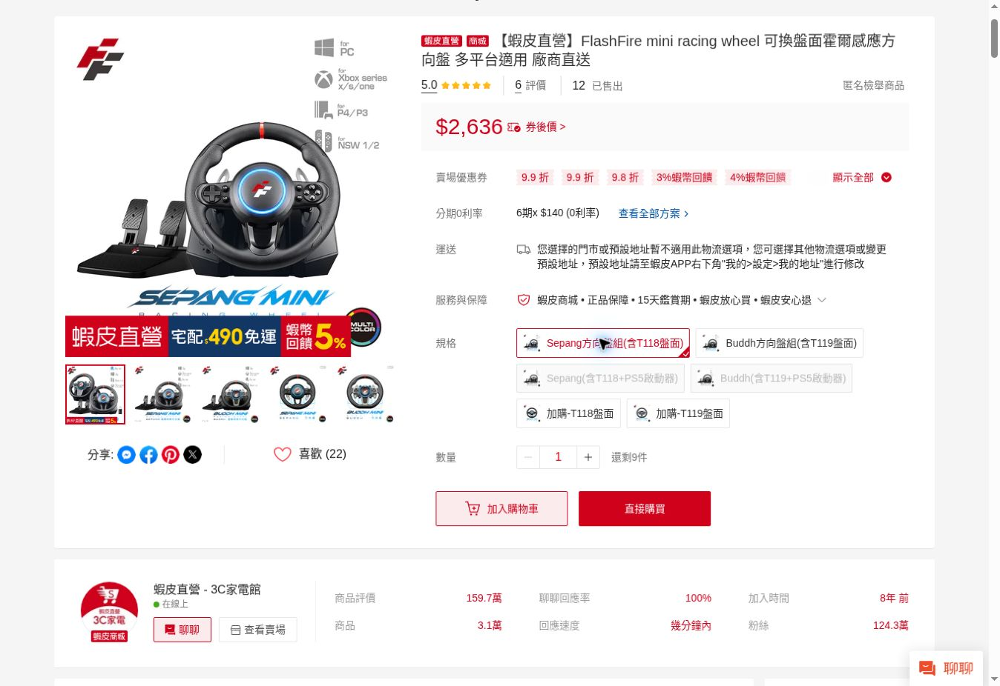

# shoppee — 瀏覽器商品任務控制台

v0.3.1 透過 Chrome／Edge 擴充功能讀取台灣蝦皮商品規格，依設定選取規格、數量並前往結帳。自動操作停在結帳頁；含運總額、最終下單與付款由使用者確認。並未實作自動送出最終訂單。

v0.3.1 修正等待診斷：以前「商品頁仍在變動」也可能代表價格讀不到或規格未選成功。現在等待上限為 12 秒，仍要求購買資料連續穩定 1.2 秒，並區分單價、規格、數量、配送及實際變動欄位；頁面標題動畫不重設等待。介面會顯示最近讀到的單價。這不能保證修復所有商品的 DOM 讀取問題。

從舊版更新時，請關閉程式、解壓新版，在擴充功能管理頁重新載入新版 `companion-extension`，再重新整理蝦皮商品頁和本機 UI，按「連接瀏覽器」重新讀取。啟動時間留白代表立即開始；過去的時間會使「排程喚醒遲到」顯示較大數值，這不是 HTTP 延遲。

## 下載與開始

下載 [v0.3.1](https://github.com/ctfpanda17/shoppee/releases/tag/v0.3.1) 並完整解壓縮。

1. 在 chrome://extensions 或 edge://extensions 開啟開發人員模式，載入包內 `companion-extension` 資料夾。詳細權限與行為見 [擴充功能說明](companion-extension/README.md)。
2. 雙擊 Windows 的 `START_UI.cmd`，或執行 `./shoppee-core ui`。在裝有擴充功能的同一個瀏覽器開啟本機 UI，按「連接瀏覽器」。若預設瀏覽器不同，複製程式顯示的完整本機網址到 Chrome／Edge。
3. 貼商品完整網址，按「讀取真實規格」。需要登入／網站驗證時，在蝦皮商品分頁親自處理，再重新讀取。密碼與 Cookie 不會由程式讀取或匯出。
4. 選擇每個規格、數量、商品小計上限與啟動時間，再開始任務。停用規格不可選，不會自動替換成其他商品。小計上限為可見單價 × 數量，不含運費。
5. 到點後程式選規格與數量，再讀取頁面資料。配送不可用、超過預算、庫存不足或資料不明確就停止；通過檢查才點一次「直接購買」。在蝦皮結帳頁親自確認最終訂單與付款。

請保留程式與本機 UI 分頁開啟。時間採電腦本地時區，最多排未來七天。核心以單調時鐘排程，但擴充功能與瀏覽器排程也會影響派發時間，不能視為硬即時。中止工作不能撤回已派發的頁面動作；若無法確認是否進入結帳，程式停止且不自動重點購買。

## 本次實測

已在提供的 FlashFire 商品正常登入後讀取到以下規格：

| 規格 | 觀測時按鈕狀態 |
|---|---|
| Sepang方向盤組(含T118盤面) | 可選，已驗證選取 |
| Buddh方向盤組(含T119盤面) | 可選 |
| Sepang(含T118+PS5啟動器) | 停用 |
| Buddh(含T119+PS5啟動器) | 停用 |
| 加購-T118盤面 | 可選 |
| 加購-T119盤面 | 可選 |

選取 Sepang 後當時顯示 NT$2,636、剩 9 件，並顯示預設地址／門市不適用配送。因此未繼續結帳或建立訂單；不能宣稱完整購買已驗證。擴充功能的完整本機安裝／連動仍需在使用者自己的 Chrome／Edge 驗證。網站 DOM 與資料可能改變；不支援的頁面會停止，不猜測控制項。



## 架構與開發驗證

`src/browser_bridge.rs` 是有期限、只租用一次的本機指令 Broker；`companion-extension` 操作可見 DOM；本機 UI 保存選擇與排程。擴充功能沒有 Cookie／密碼／debugger 權限，不讀取訂單歷史或配送地址內容，不呼叫私有 API，不自動處理登入、驗證碼或繞過安全限制。橋接僅把公開商品標題、規格、可見價格、庫存及配送限制旗標交回本機服務。

UI API 保留隨機工作階段、Host／Origin／CSP 檢查與資料大小上限。擴充功能只接受由本機 UI 的「連接瀏覽器」按鈕啟用的商品指令，商品 URL 限定台灣蝦皮已解析的 canonical URL。最後訂單與付款不在指令集合中。

```sh
cargo test --locked --all-targets
cargo clippy --locked --all-targets -- -D warnings
cargo build --locked --release
npm ci --ignore-scripts
npm test
```

Rust 測試驗證 Broker、SKU／數量／預算／配送、取消與拒絕不符回報；DOM 測試使用已觀測的商品結構 fixture。這些測試不代表所有商品的實際結帳已成功。使用者的 UI 執行環境不需要 Node.js／Python。

「蝦皮商品頁」模式只開啟商品頁；「本機模擬」自動管理模擬伺服器、固定 NT$99 報價及模擬確認。模擬報價不是實際商品價，所有 HTTP 分位數只代表該本機流程。原始效能報告是 v0.1.0 的歷史基準。

## 舊有命令列功能

以下 mock／run／bench／probe 指令保留。直接執行而不加參數，現在會啟動 UI。

## 快速開始

需求：Rust 1.99+、curl 7.70+。測試與 TLS 範例另需 OpenSSL CLI；重現報告需 Python 3。Cargo.lock 已提交。

```sh
cargo build --locked --release
cargo test --locked --all-targets
cargo fmt --all --check
cargo clippy --locked --all-targets -- -D warnings
```

第一個終端啟動本機模擬伺服器：

```sh
cargo run --locked --release -- mock --release-after-ms 3000 --delay-ms 10
```

另一個終端執行：

```sh
cargo run --locked --release -- run --product coffee --max-price-minor 10000 --currency TWD
```

金額以最小貨幣單位表示，例如 TWD 9900 表示 NT$99.00。輸出 `awaiting_user_confirmation` 與 30 秒有效的非約束報價。使用者必須在平台正式確認商品、數量、運費、總額及付款；本程式沒有執行付款的方法。報價逾時、價格超標、幣別不符都會失敗。

`--at-unix-ms <UTC epoch milliseconds>` 在預熱讀取後以單調時鐘等到指定時間，再開始監測。`--budget-secs 30` 限制監測全流程。若需要觀察未開賣 → 開賣的轉換，請讓模擬伺服器的 release-after-ms 足夠長。Ctrl+C 可取消等待與網路工作。

## 架構

| 模組 | 行為 |
|---|---|
| `client.rs` | Tokio 非同步 reqwest、單一共享連線池、TCP_NODELAY、連線與整體請求 timeout、讀完 body 促進連線重用 |
| 共用節流器 | 所有 Api clones 共用起始時間閘門；預設至少 250ms 一次，不使用忙迴圈或多 IP／多帳戶規避限制 |
| 重試 | 僅冪等 GET；連線／timeout、429、502–504；最多 3 次，指數退避加 jitter；遵守秒數及 HTTP-date Retry-After |
| 停止條件 | 401/403 停止該 client；異常 JSON、過大 body、其他 4xx 不重試；伺服器等待超過 60 秒預算時停止，不縮短伺服器限制 |
| `schedule.rs` | UTC epoch 轉單調 deadline；記錄喚醒遲到量，不自動提前發送、不保證硬即時精度 |
| `model.rs` | 商品與非約束報價契約、價格／幣別／有效期檢查、強制 requires_user_confirmation |
| `metrics.rs` | 每次嘗試的成功狀態、HTTP code、排隊／headers／body／JSON 處理／總耗時及 nearest-rank P50/P95/P99 |
| `probe.rs` | 隔離的冷連線 curl 診斷；不在搶購熱路徑啟動子程序；不追蹤重導向、驗證 TLS、保留代理環境 |
| `mock.rs` | Axum loopback 模擬、定時開賣、延遲注入、429／503 注入及統計 |

退避時間會進入後續 request 的 queue 指標；workflow_ms 才是整個監測到報價的時間。JSON processing_ms 只量反序列化，並非整個程式 CPU 時間。樣本保存在記憶體，適合有限時段執行；長期服務應接入有界 telemetry sink。

## 模擬故障

```sh
cargo run --release -- mock --rate-limit-first 1 --fail-first 1
```

第一個請求 429（Retry-After: 1），第二個 503，後續成功。`/stats` 顯示 requests、quotes、payment_requests；模擬伺服器沒有付款路由。測試會直接計數已接受的 TCP socket，確認同一 Rust client 的多次請求確實重用連線。

## 效能量測

伺服器啟動後：

```sh
cargo run --locked --release -- bench --samples 100 > benchmark.json
python3 scripts/benchmark.py --samples 100
```

第二個命令會自動啟動／關閉兩組 HTTP mock（0ms、10ms 注入）與一個自簽 TLS OpenSSL 測試伺服器；產生 reports 中的原始樣本、分位數、排程流程及環境資訊。25ms 的取樣間隔僅用於此 loopback 實驗。遠端速率必須符合授權介面的規範。

`bench` 的三個依序測量組別：

1. 新 curl process 的冷連線：分解 DNS、TCP、TLS、request-to-first-byte、body、total。
2. 每次建立 reqwest client 的對照組：量 client 建立時間及 HTTP service 時間。
3. 一次預熱後共用 reqwest client：量 pool 重用時的 service、queue、JSON processing 等時間。

第一次發生冷探測錯誤便停止整個 benchmark，避免忽略 429 後繼續請求；Rust 量測也在錯誤後停止。成功分位數不混入失敗時間；報告保留失敗數及狀態，不能只看成功延遲。

| 指標 | 定義／限制 |
|---|---|
| DNS | curl time_namelookup；可能命中 OS cache；IP literal 不代表真實 DNS 解析延遲 |
| TCP | time_connect − time_namelookup |
| TLS | HTTPS 的 time_appconnect − time_connect；HTTP 為 null，不填 0 |
| HTTP request-to-first-byte | time_starttransfer − time_pretransfer；包含傳輸、排隊、伺服器處理，不能稱為純伺服器 CPU 時間 |
| curl total | time_total；不包含啟動 curl process 的時間；上述各 phase 不一定完整涵蓋 total，另有 pretransfer 等開銷 |
| pooled headers | Rust send 到 headers 完成；包含網路、伺服器與任何重新連線，不虛構其中 DNS／TLS 拆分 |
| service | headers + body + JSON processing；比較 reqwest fresh 與 pooled 時主要看這項 |
| queue / total | queue 是節流／退避等待；total 包含 queue，不能拿它直接與 curl total 比較 |

HTTP client、協定版本、TLS backend、代理和測試順序都會影響結果。fresh 與 pooled 是同一 reqwest 的實用對照，但 OS cache 與時間順序仍是混雜因素；不能把所有差值都歸因於 Rust 或連線池。Raw cold 樣本含 remote_ip、HTTP version、連線數及可用時的 proxy_used。走代理時 DNS/TCP 可能是代理路徑，HTTPS TLS 差值可能包含 CONNECT，並不代表直連原站的各段。

P99 用 nearest-rank，100 筆時是第 99 個排序值，尾端估計仍不穩定；正式比較應在授權配額內增加樣本、交錯／重複測量並比較失敗率。各階段 P95 不可直接相加當成 total P95。

### TLS 階段

`cargo test` 會產生一次性自簽 localhost 憑證並啟動 OpenSSL HTTPS 伺服器，確認未受信任憑證失敗，明確指定測試 CA 後成功且 TLS 耗時大於零。重現腳本提供 100 筆 TLS 分位數。這個 OpenSSL 回應與 Axum HTTP mock 的內容／伺服器不同，不能直接相減推論 TLS 的淨成本。

若有自己的合法授權 HTTPS 測試服務，可使用：

```sh
cargo run --release -- probe --url https://YOUR_AUTHORIZED_HOST/health --authorized-remote --samples 100 --interval-ms 1000
```

不需要 `--insecure`，也沒有忽略 TLS 憑證的選項。`--ca-cert` 僅供明確信任的測試 CA。

## 如何找真正瓶頸

先看失敗率、429、queue 與 schedule_lateness_ms，再分辨 DNS／TCP／TLS／HTTP service 與本機 JSON processing。對照 0ms、10ms 注入的變化可以驗證量測是否能定位伺服器／網路等待。請閱讀 [實測結果](reports/ANALYSIS.md)。本機結果只能證明量測與流程，不代表蝦皮尖峰服務或任何實際搶購成功率。

要比較實際網路路徑，應在允許的不同主機／ISP／地區執行相同版本、參數及授權目標，記錄端點、協定、代理、取樣時段與失敗率，優先比較 service P95/P99。此程式不修改路由、不硬編碼 CDN IP、不競速發送多份下單；目前沒有資料能判定台灣使用者的最佳網路路徑。

## 未來平台整合契約

目前 `/products/{id}`、`/quotes/{id}` 是本專案 mock 的 JSON 格式，**不是蝦皮 API**。正式 adapter 必須由平台核准的 API／SDK 實作，從環境或安全儲存取得權杖、遵守核准配額、對應商品與價格資料、停在使用者確認。不要把私有網頁端點或逆向簽章填入此契約。無授權的正式商品／結帳介面時，不啟用正式交易。

不得自動解 CAPTCHA、模擬通過安全挑戰、規避平台限流或重播付款。新增正式下單功能前需重新設計報價綁定、使用者一次性確認、冪等鍵、重複訂單防護、庫存與價格再驗證，以及敏感資料遮蔽。本版本刻意只有 read-only 準備能力。

參考：[reqwest Client 連線池](https://docs.rs/reqwest/0.12/reqwest/struct.Client.html)、[curl write-out 計時定義](https://curl.se/docs/manpage.html#-w)、[Tokio sleep_until](https://docs.rs/tokio/latest/tokio/time/fn.sleep_until.html)。
